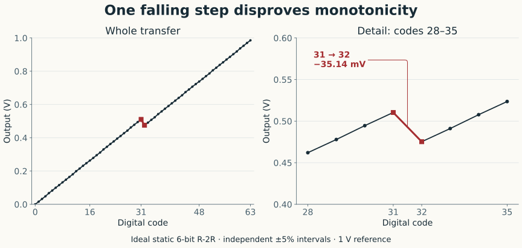
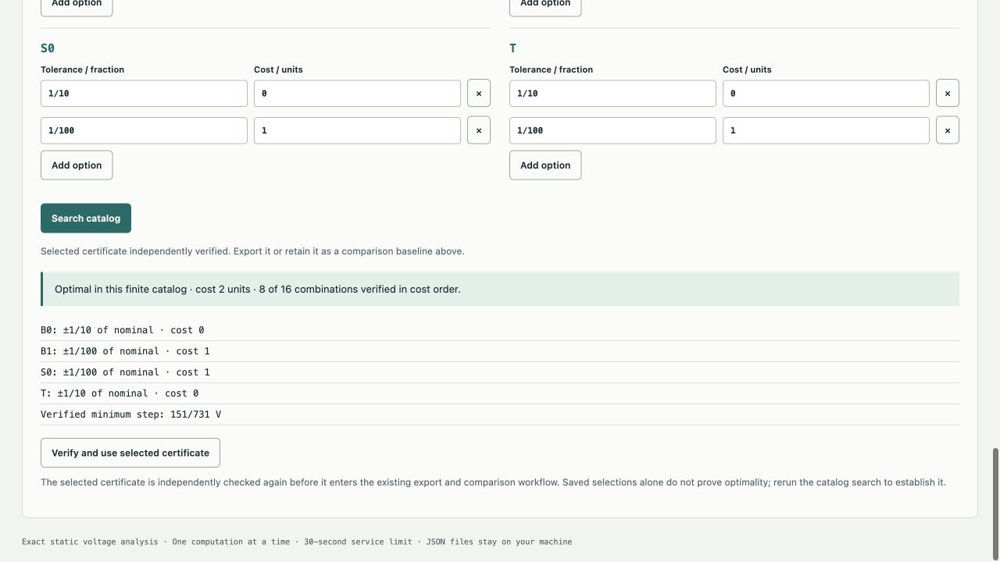
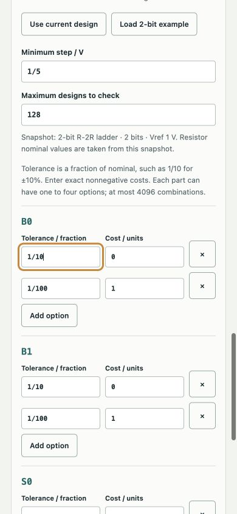

# LadderProof

**The code rises. The voltage falls.**

Find the exact resistor assignment that makes an ideal R-2R digital-to-analog
converter step backward. Inspect the circuit, export its result, and recheck every
admitted corner with an independent verifier.

[Verify a result](#verify-the-included-results-without-installing) · [Open the workbench](#try-the-complete-workflow) · [Choose component tolerances](#choose-a-tolerance-allocation) · [Model and assumptions](#model-and-limits)

<picture>
  <source media="(max-width: 600px)" srcset="docs/presentation/falling-step-mobile.svg">
  
</picture>

At a 1 V reference, the six-bit ±5% model admits a **31 → 32 decrease of
−269227/7660721 V**, approximately **−35.14 mV**. The whole-transfer view and
its detail use the same physical resistor assignment. These are exact ideal
circuit calculations, not hardware measurements.
[Exact data, resistor values and reproduction](docs/presentation/README.md).

- **Independent ±5% intervals:** worst adjacent step −269227/7660721 V. A decrease is attainable.
- **Independent ±1% intervals:** worst adjacent step 186147971/34016602567 V. Every admitted adjacent step is positive.

The verifier checks all 4,096 corners for each model. The two cases use their own
attaining assignments; they are not measurements of one physical device.

[Inspect the complete circuit workbench](docs/workbench.jpg), including the
attaining resistor assignment, or read the [verification record](docs/verification.md).

## Verify the included results without installing

Python 3.11+ and the standard library are enough after cloning:

```sh
git clone https://github.com/nazeeh111/LadderProof.git
cd LadderProof
PYTHONPATH=src python3 -m ladderproof verify examples/six-bit-five-percent.certificate.json
PYTHONPATH=src python3 -m ladderproof verify examples/six-bit-one-percent.certificate.json
```

Each command rechecks all 4,096 admitted resistor corners. The five-percent
case reports `nondecreasing: false`; the one-percent case reports `true`.
Both are ideal static models, not physical measurements or yield estimates.

## Try the complete workflow

Python 3.11 or newer is required. Runtime dependencies are all in the standard library. This checkout identifies itself as development version `0.1.3.dev0`. Install this checkout in a virtual environment:

```sh
python3 -m venv .venv
.venv/bin/python -m pip install .
.venv/bin/ladderproof serve
```

The browser application listens on the local loopback address. Use the terminal's URL. You can also perform every analysis/export/verification step from the CLI:

```sh
.venv/bin/ladderproof create --bits 6 --tolerance 1/20 --vref 1 --output loose.json
.venv/bin/ladderproof analyze loose.json --output loose-certificate.json
.venv/bin/ladderproof verify loose-certificate.json
.venv/bin/ladderproof create --bits 6 --tolerance 1/100 --vref 1 --output tighter.json
.venv/bin/ladderproof analyze tighter.json --output tighter-certificate.json
.venv/bin/ladderproof compare loose-certificate.json tighter-certificate.json
```

Edit the generated JSON to enter measured ranges or different nominal values for individual components. All numbers are exact strings such as `"2000"`, `"1999.125"` or `"15992/8"`. Certificate export normalizes them to reduced fractions; no binary floating-point values enter the analysis. Existing files are protected unless `--force` is supplied. A refused or interrupted computation cannot replace an earlier output even with `--force`. If interruption happens during the final atomic publication, the CLI asks you to check whether the complete new file was already written.

The six-bit examples in [examples/](examples/) demonstrate a real distinction: at independent ±5% resistance variation, a 31→32 decrease is attainable; at ±1%, every modeled adjacent step remains positive. At a 1 V reference the exact minimum steps are respectively `-269227/7660721 V` and `186147971/34016602567 V`. These are reproducible synthetic circuit calculations, not measurements from hardware.

## Choose a tolerance allocation

In the local workbench, choose **Allocate tolerances**, then **Load 2-bit example**.
Edit each resistor's listed tolerance fractions and additive costs, set the exact
minimum voltage step and search limit, and select **Search catalog**. An optimal
selection can be independently verified and brought into the existing workbench
for certificate export or comparison. **Use current design** snapshots the current
nominal values and reference. Changes to the design after that snapshot do not
change the catalog; select it again to refresh the snapshot.

**Save catalog** stores that complete snapshot, every tolerance/cost option and
the exact threshold in the existing CLI request format. **Open catalog** restores
these inputs without changing the current design or certificate; search again
to establish a result. Invalid or superseded imports retain current work. Saved
DNL thresholds retain their normalized LSB units rather than becoming volts.
Search limits are operational settings and are not included in the request file.
The saved file can also be passed directly to `ladderproof catalog`.



The synthetic example searches a finite set of ideal resistor intervals. Its costs are arbitrary additive units.



A finite catalog can trade user-defined component cost against a required exact
minimum step. The bundled synthetic two-bit example offers independent ±10% or
±1% per resistor and requires at least 1/5 V at a 1 V reference:

```sh
.venv/bin/ladderproof catalog examples/tolerance-catalog.json --output selection.json
.venv/bin/ladderproof choose selection.json --output chosen-certificate.json
.venv/bin/ladderproof verify chosen-certificate.json
```

The optimum tightens B1 and S0 for total cost 2, versus cost 4 for tightening every
component. Its exact worst step is 151/731 V; the all-loose baseline is 68/409 V
and misses the constraint. These are declared synthetic cost units and ideal
resistor intervals, not part prices or a physical device guarantee.

Search uses exact cost order and complete independent circuit verification. It
returns `optimal`, `infeasible` only after exhausting the catalog, or `unfinished`
when its candidate/corner/deadline budget stops. The default candidate limit is
128; use `--max-designs` / `--max-corner-solves` explicitly for larger work.
An unfinished search exits 3 and cannot replace an existing file. Reopen the
chosen certificate in the existing workbench, or compare it to a baseline using
`ladderproof compare`. The [catalog contract](docs/contracts.md#finite-tolerance-catalog)
explains exact input, normalized DNL constraints and saved-report verification.

## Model and limits

Enter an independent resistance interval for each component. The analysis enumerates every admitted interval corner using exact fractions.

This is a small electrical analysis application, with an installed CLI and a local browser interface. It models 2–6 bit voltage-mode ladders with ideal switches, a fixed positive reference and an unloaded output. The result concerns the declared static resistor model. Actual switching glitches, settling, temperature, reference regulation and physical devices are outside it. See [the model and mathematical argument](docs/model.md).

## What the application computes

The nodal solver performs exact Gaussian elimination at every unique tolerance-box corner. Code steps compare **the same physical resistor assignment** on both sides. Every resistor has its own coordinate; fixed intervals do not add redundant corners. The largest admitted ladder has 12 resistors and 4,096 corners. Per-code voltage bounds and every adjacent-step bound include the lowest-mask endpoint witness that attains them.

The verifier uses independent backward Thevenin reductions, not the nodal solver. It re-enumerates all corners and recomputes all bounds, nominal values and witnesses. It validates global claims instead of only checking that the single adverse example is attainable. The exported record is a replayable computation certificate, not a succinct formal proof or cryptographic attestation.

The method and DAC architecture are established. The contribution here is bounded exact implementation, explicit component assumptions, inspectable attained transitions, complete independent verification and the usable analysis/edit/export workflow. [Model references](docs/references.md) explain the circuit analysis and exact bounds; this project is not a SPICE replacement.

## Limits and failures

Analysis and verification have an operation deadline, 30 seconds by default and at most 120 seconds. Use `--seconds 60` for an analysis requiring more local time. Cancellation, invalid models and resource refusal have distinct outcomes. No partial result acquires complete certificate status. The admitted bit count, exact-number sizes and JSON size are bounded before solving; see [the contract](docs/contracts.md).

An independent interval box can overstate what a matched or correlated resistor family permits. Do not treat its endpoint witness as an attainable correlated assignment, or interpret it as manufacturing yield. Correlations, arbitrary graph/netlist imports and nonlinear parts are deliberately refused.

## Development checks

```sh
PYTHONPATH=src python3 -m unittest discover -s tests -v
node --test tests/frontend.test.cjs
```

The tests exercise independently derived analytic ladders, the six-bit successful and failing interval cases, nonuniform values, certificate mutation, complete verification, cancellation, hostile inputs and the real CLI save/reopen/compare journey. [Verification notes](docs/verification.md) distinguish executed checks from remaining release checks.

Original code is MIT licensed. No credentials, remote service or hardware is required.
